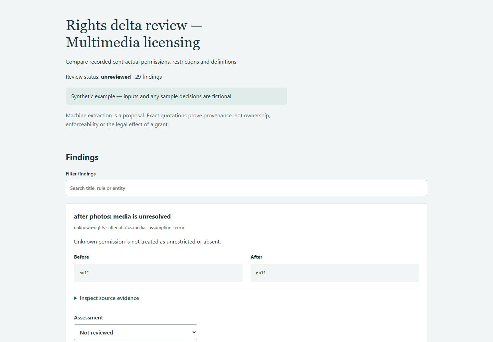

# Complex matter verification — 0.1.1

All inputs, parties, systems, plans and sign-offs in this rehearsal are synthetic.
Expected-result ledgers are authored independently of engine output and stored in
`examples/multimedia-licence/expected.json`. They test calculations and recorded comparisons;
they do not provide independent legal or survey validation.

## Subject matter and results

A multimedia agreement has four grants in each draft, with grant reordering,
one removed translation grant and one added audio grant. The illustration grant
changes licensee, rights, territories, media, exclusivity, sublicensing, term,
restrictions and the definition of the work. Photo territories/media become APAC/digital.

The independent ledger expects 11 recorded-rights deltas, one added grant and one
removed grant. Reordering the rights and retaining the archive grant produces no
spurious delta. Unknown APAC/digital scope stays unknown; it never becomes worldwide
or unrestricted. The entire run contains 29 findings, including extraction reviews
and text needing classification.

Overriding model-training approval and archive confidentiality clauses remain quoted
and flagged. The tool does not resolve their legal effect. The synthetic review leaves
8 findings pending, including unsupported wording and scope questions. Even non-operative
headings remain accounted for; a real reviewer can dismiss them with a reason.

The complex case passed without a licence-engine correction. This validates the bounded
schedule/structured-register route. It does not demonstrate reliable extraction from
arbitrary negotiated contracts, scans or unrestricted drafting styles.



## Reproduce the complete journey

Install from the README, then run from the repository root:

```bash
python scripts/rehearse_complex.py --out out/complex-rehearsal
```

This synthetic-only command analyses the matter, freezes the evidence, records labelled
synthetic decisions, exports a reviewed report and verifies it. It deliberately leaves
unresolved questions pending. Open `out/complex-rehearsal/analysis/review.html` to make
your own review; save new decisions and finalize into a separate fresh directory.
The output `rehearsal.json` records finding/pending counts and states that no external
action or legal clearance has been established. Existing outputs are never overwritten.

For the actual browser regression, install Playwright as described in the README and
set `BROWSER_SCENARIO=scripts/complex-scenario.json` before running
`node scripts/verify_browser.mjs`. In PowerShell use
`$env:BROWSER_SCENARIO='scripts/complex-scenario.json'` first. It tests desktop/mobile,
filtering, incomplete-review refusal, correction overlays, decision download, final
export and pending-status preservation.

## Product status

39 local unit/end-to-end tests pass. The browser journey passes with no page errors
or horizontal mobile overflow. Full-suite and clean-wheel checks also run in CI.
See [the execution record](complex-verification.json) and the repository's Actions tab.

This is evidence that the bounded workflow executes on harder cases. It is not evidence
that the product can resolve arbitrary subject matter or replace responsible review.
